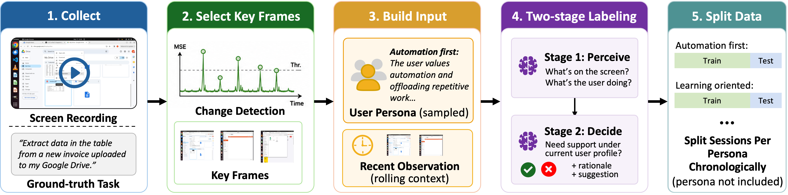

# OSWorld-Persona Data Synthesis

This package implements a general pipeline for repurposing computer-use recordings or trajectories into personalized proactive-agent data.

<p align="left">
    
</p>

## Pipeline

The pipeline has five stages:

1. **Collect:** Pair screen recordings or computer-use trajectories with their task instructions.
2. **Extract key frames:** Select frames that capture meaningful screen-state transitions using per-pixel mean squared error.
3. **Build personalized instances:** Group chronological key frames into rolling context windows and pair each window with user personas describing different preferences and behavior patterns.
4. **Label interventions:** First use a vision-language model to infer the current observation and user intent without persona information. Then use a persona-conditioned labeler to decide whether proactive support is wanted and produce its rationale and optional suggestion.
5. **Split by time:** Split complete labeled sessions chronologically into train and test sets for each persona, keeping every window from a source session in the same split.

The released OSWorld-Persona dataset uses trajectories from [OSWorld v2](https://github.com/xlang-ai/OSWorld-V2) and includes four personas. The pipeline itself can be applied to any other computer-use data and personas.

## Inputs

Every source session requires a task instruction. Provide a JSON mapping from session IDs to instructions:

```json
{
  "session-001": "Create a report from the supplied notes.",
  "session-002": "Update the spreadsheet and save it as an XLSX file."
}
```

The instruction grounds screen perception but is not shown to the persona-conditioned labeler. JSON lists and JSONL files with `session_id` and `instruction` fields are also accepted.

For screenshot trajectories, use this layout:

```text
<trajectory-root>/<session-id>/trajectory.jsonl
<trajectory-root>/<session-id>/<frame-files>
```

Each JSONL row identifies a chronological frame:

```json
{"image_path":"screens/0001.png","index":1,"t_seconds":0.0}
{"image_path":"screens/0002.png","index":2,"t_seconds":4.2}
```

For screen recordings, use either layout:

```text
<recordings-root>/<session-id>.mp4
<recordings-root>/<session-id>/recording.mp4
```

## Run Synthesis

[`cli.py`](cli.py) is exposed as `uv run osworld-persona-synthesize`. Its main commands are `trajectory`, `video`, `consistency`, `review`, `split`, and `profiles`.

Synthesize from screenshot trajectories:

```bash
uv run osworld-persona-synthesize trajectory \
  --traj-root "<trajectory-root>" \
  --instructions "<instructions.json>" \
  --out-dir "<output-dir>" \
  --base-url "<openai-compatible-base-url>/v1" \
  --api-key "<api-key>" \
  --model "<vision-language-model>" \
  --user-profiles automation_first,eager_handson,learning_oriented,reserved_drafts \
  --tool-profiles full_suite
```

Or synthesize directly from screen recordings:

```bash
uv run osworld-persona-synthesize video \
  --recordings-root "<recordings-root>" \
  --instructions "<instructions.json>" \
  --out-dir "<output-dir>" \
  --base-url "<openai-compatible-base-url>/v1" \
  --api-key "<api-key>" \
  --model "<vision-language-model>" \
  --user-profiles automation_first,eager_handson,learning_oriented,reserved_drafts \
  --tool-profiles full_suite
```


## Validate and Split

Apply text-only self-consistency validation:

```bash
uv run osworld-persona-synthesize consistency \
  --input "<output-dir>/dataset.jsonl" \
  --base-url "<openai-compatible-base-url>/v1" \
  --api-key "<api-key>" \
  --model "<language-model>" \
  --samples 3
```

Create leakage-safe train and test files:

```bash
uv run osworld-persona-synthesize split \
  --input "<output-dir>/dataset_consistent.jsonl" \
  --out-dir "<output-dir>/split" \
  --test-ratio 0.2
```